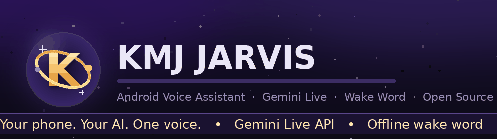
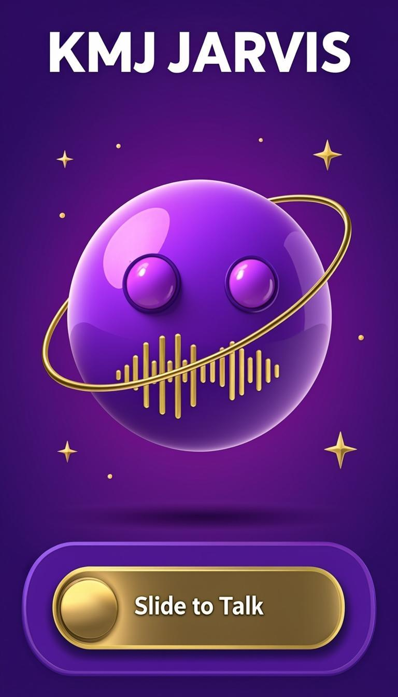
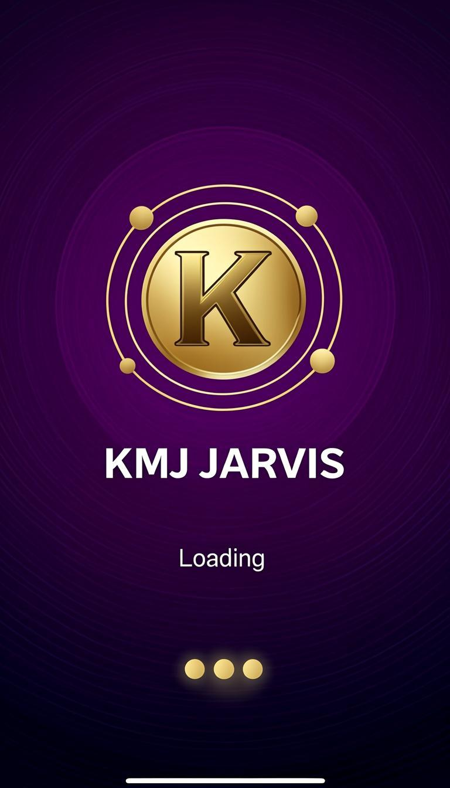
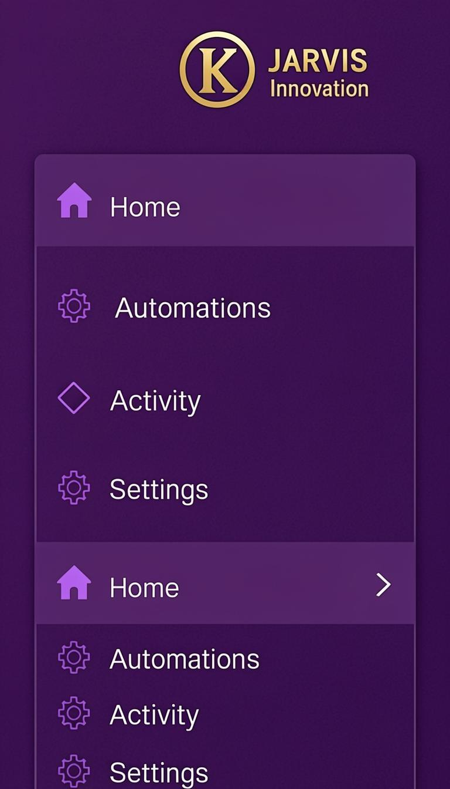
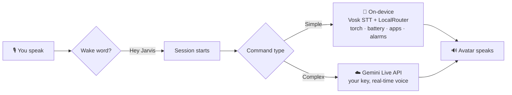

<div align="center">



# 💜 KMJ JARVIS

### *Your phone. Your AI. One voice.*

**A full voice assistant for Android — Gemini Live conversations, offline wake word,
on-device commands, and a custom purple-gold UI with a living 3D avatar.**


**⬇️ DOWNLOAD NOW — FREE & OPEN SOURCE ⬇️**

[-113_MB-8B5CF6?style=for-the-badge&logo=android&logoColor=white)](https://github.com/KMJ-TIPS/KMJ-JARVIS/releases/latest/download/KMJ-JARVIS-1.2.1-debug-full.apk)
[](https://github.com/KMJ-TIPS/KMJ-JARVIS/releases/latest/download/KMJ-JARVIS-1.2.1-release.apk)

[](https://github.com/KMJ-TIPS/KMJ-JARVIS/releases)

[](https://kmj-tips.github.io/KMJ-JARVIS-DOWNLOADER/)

</div>

---

> **💡 Tip:** *Full APK* me wake-word models included hain — install karke bas **"Hey Jarvis"** bolo, phone jawab dega! 🔥

---

## ✨ What Makes It Special

| | Feature | Details |
|---|---|---|
| 🧊 | **Living 3D Avatar** | A glossy orb that **blinks, wanders its gaze, squints while speaking**, wobbles to your voice, and wears two orbiting satellite rings with real 3D depth |
| 🎚️ | **Slide-to-Talk** | No tap buttons — drag the glossy 3D mic knob to start a session, drag back to stop. Spring physics + gold glow |
| 🌙 | **Animated Splash** | Logo springs in over a breathing glow with racing dots |
| 🔐 | **One-Page Permissions** | Every essential permission in a single **"Allow all"** Android dialog |
| 🎙️ | **Offline Wake Word** | openWakeWord ONNX models run 100% on-device — *"Hey Jarvis"* wakes it hands-free |
| ⚡ | **Gemini Live API** | Real-time, low-latency conversations with your own free API key |
| 📴 | **On-Device Commands** | Torch, battery, time, media, apps, alarms — no internet needed (Vosk STT) |
| 🧭 | **Left Drawer UI** | Clean sidebar navigation — Home, Automations, Activity, Settings |
| 🛡️ | **Private by Design** | Wake-word audio never leaves the phone; Gemini hears you only during a session |
| 💜 | **Purple & Gold** | Custom Material 3 theme — violet `#8B5CF6` + gold `#FFC24B`, light & dark |

---

## 📱 UI Preview

<div align="center">
<table>
  <tr>
    <td align="center"><br/><sub><b>🏠 Home — 3D Avatar + Slide to Talk</b></sub></td>
    <td align="center"><br/><sub><b>🌙 Splash — Logo Reveal</b></sub></td>
    <td align="center"><br/><sub><b>🧭 Drawer — Sidebar Navigation</b></sub></td>
  </tr>
</table>
<sub><i>UI preview (design mockup) — actual app follows the phone's light/dark mode.</i></sub>
</div>

---

## 🚀 Install (2 Minutes)

### Step 1 — Download the APK
| Build | Size | Best For |
|---|---|---|
| **[KMJ-JARVIS-1.2.1-debug-full.apk](https://github.com/KMJ-TIPS/KMJ-JARVIS/releases/latest/download/KMJ-JARVIS-1.2.1-debug-full.apk)** ⭐ | ~113 MB | **Recommended** — wake word + all features |
| **[KMJ-JARVIS-1.2.1-release.apk](https://github.com/KMJ-TIPS/KMJ-JARVIS/releases/latest/download/KMJ-JARVIS-1.2.1-release.apk)** | ~86 MB | Smaller, R8-optimised (no wake-word models) |

### Step 2 — Install
1. **Uninstall any older KMJ JARVIS build first** (updates need the same signature)
2. Open the APK → allow *"Install unknown apps"* if asked
3. Watch the **splash** ✨ → grant permissions with **"Allow all"**
4. Paste your free **Gemini API key** → **Start** 🎉

### Step 3 — Get Your Free Gemini Key
- Visit **[aistudio.google.com](https://aistudio.google.com/)** → *Get API key* → *Create API key*
- It's **free** — the key stays in your phone's secure keystore, never uploaded

### Step 4 — Talk!
- **Slide the button to talk**, or just say **"Hey Jarvis"** (Full APK)
- Tap the avatar anytime to **cut in while it's speaking**

---

## 🎙️ Wake Words

Say any of these while the app is open and hands-free mode is on:

```
"Hey Jarvis"   ·   "Hey KMJ"   ·   "KMJ Jarvis"   ·   "Jarvis"   ·   "KMJ"
```

> Wake-word detection runs **fully offline** (openWakeWord). Nothing is recorded or sent
> until the wake word fires and a session starts.

---

## 🛠️ Build From Source

```bash
git clone https://github.com/KMJ-TIPS/KMJ-JARVIS.git
cd KMJ-JARVIS
# Android SDK 35 + NDK 27 required; write local.properties:
echo "sdk.dir=/path/to/android-sdk" > local.properties
./gradlew :app:assembleDebug          # → app-debug.apk (wake word included)
```

**Signed release:** the release build reads `KMJ_KEYSTORE` + `KMJ_KEYSTORE_PASSWORD`
environment variables (your own keystore, alias `jarvis`).

**Requirements:** Android Studio / SDK 35 · NDK 27.0.12077973 · CMake 3.22.1 · JDK 17+

---

## 🧠 How It Works



---

## 📂 Tech Stack


- **Kotlin 2.0 + Jetpack Compose + Material 3** — 100% declarative UI
- **Gemini Live API** — real-time bidirectional voice (user-supplied key)
- **openWakeWord** (ONNX) — offline "Hey Jarvis" detection
- **Vosk** — offline STT for local commands
- **SpeexDSP (C++/JNI)** — echo cancellation so the avatar can speak and listen
- **minSdk 29 (Android 10) · targetSdk 35**

---

## 🔒 Privacy

- ✅ Wake-word audio **never leaves the phone**
- ✅ Local commands run **100% on-device**
- ✅ Your Gemini key lives in the **Android secure keystore**
- ✅ No ads, no analytics, no tracking
- ☁️ Only what you ask Gemini leaves the phone — over your own key

---

## 🗺️ Roadmap

- [x] v1.0.0 — Full rebrand, purple-gold theme, new icons
- [x] v1.1.0 — Slide-to-Talk + living 3D avatar
- [x] v1.2.0 — Splash screen, left drawer, one-page permissions, pro logo
- [x] v1.2.1 — Echo cancellation fixed (native AEC now loads and links)
- [ ] v1.3.0 — Hindi wake word, more automations

---

## 📄 License & Credits

KMJ JARVIS is an independent KMJ rebrand and feature fork of the open-source
[Shilex voice assistant](https://github.com/h4harshill/jarvis-android) (GPL-3.0).
Upstream copyright and license notices are preserved in [`LICENSE`](LICENSE) and
[`NOTICE`](NOTICE), as the GNU GPL v3 requires. The rebrand, avatar, UI, and
branding are new work.

Licensed under **[GNU GPL v3](LICENSE)**.

---

<div align="center">

**⭐ Star this repo if KMJ JARVIS makes your phone smarter! ⭐**


<sub>Made with 💜 and a little gold · **KMJ JARVIS** v1.2.1 · *Your phone. Your AI. One voice.*</sub>

</div>
